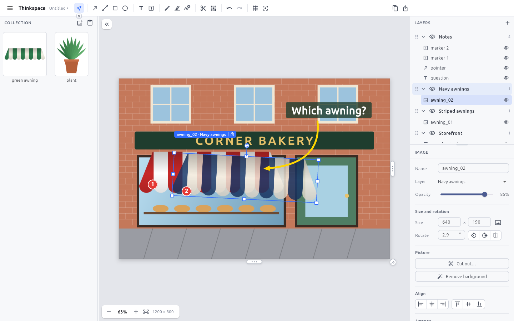

# Thinkspace

A small, quick place to get an idea out of your head and onto a page — to show someone what you mean.

Paste a screenshot or a photo, drop in more pictures, draw an arrow at the part that matters, fade one option, hide another, and send the result. It is what you reach for when GIMP is too slow, Paint is too thin and you do not want to learn a drawing suite.



Thinkspace is **not** a photo editor, a vector studio or a drafting tool. The screen stays sparse: a short toolbar, a layer list, a collection of source images, and a few properties for whatever is selected.

> Status: a working desktop app (Flutter), built and tested on Linux. A Windows build exists (see Install) and is being tried out; macOS is not attempted.

## Why it exists

Doing one small visual job used to mean bouncing between apps: one for a quick diagram, another to mark up a screenshot, another to try an idea over a photo. The pieces worth having were scattered across Xournal, GIMP and Paint.NET, and each came with a screen full of buttons. When the screen is hundreds of buttons, menus under menus and rows of status lines, the idea is gone before the work starts — even when every feature is there.

Thinkspace keeps the few things that job needs in one place, and leaves the rest out:

- **Fast, straight lines and arrows**, resizable by their ends. Drawing an arrow should never be a hoop.
- **Real pictures** — screenshots, photos, images from the web — that stay separate, movable things.
- **Layers for organising, not for effects**: show or hide, reorder, move together. A layer for the notes, a layer for one set of pictures, a layer for another.

A few rules follow from that, and every feature is weighed against them:

- **Little things stay little things.** A pasted picture, a label or an arrow remains its own object until you deliberately merge it, and merging can be undone.
- **Arranging, not painting.** Pieces are moved, sized, turned and faded, never smudged into the page. Changes that touch pixels (cutting out, removing a background) make a new picture and keep the original.
- **The screen stays quiet.** Few tools, each obvious; shortcuts are taught on the toolbar itself, not in a manual.
- **One gesture, one undo.** What your hand did once, Ctrl+Z takes back once.
- **No graphics suite.** No masks, blend modes, filters, brushes, perspective or colour management. Each would be reasonable alone; together they would make this the slow app it is meant to replace.

## What it does

- **Pictures stay separate things.** Paste, drop or import images. Each is its own object you can move, resize, rotate, fade and rename. Nothing is painted into the page until you export.
- **Fast lines and arrows.** Straight lines and arrows that you resize by dragging their ends. `Shift` snaps them to clean angles. Drag the small diamond in the middle to bend one into a curve (it snaps back straight, or to an even arc, as you get close). Also rectangles, ellipses, numbered markers, text in four typefaces (sans, serif, mono, handwriting) and a smoothed pen; hold `Shift` with the pen for a straight line.
- **Tools remember how you set them.** Each tool keeps its own colour, width and size, even after a restart, and changing something on the page changes its tool too. Each tool's settings end in a **Reset to default** link, which comes alive once they have been changed.
- **Layers that do the simple things.** Show/hide, reorder, lock, and *move everything on a layer together* — click a layer to select its contents, then drag. Drag any object onto another layer without it changing. A new layer goes just above the current one, lights up and opens its name for typing.
- **Lock things in place.** The padlock at the end of the selection's name tag (or `Ctrl+L`) locks it: a locked thing ignores clicks, so you can work on what is above it. Unlock it from its row in the Layers list.
- **A collection of source images.** Keep pictures you have gathered but not placed. Drag one onto the page to use it; the original stays in the collection to use again. Every item has its own name; click an item to select it (`Enter` places it, `Delete` removes it, `F2` renames it on the spot), and drag one onto another to rearrange the shelf (or use `[` `]`). The collection is resizable and can be hidden.
- **A highlighter.** Press `H`: drag over text in a screenshot like a marker (a quick, nearly level pass becomes a perfectly level bar; hold `Shift` for a straight line), or switch to Box and drag a rectangle over a whole area. Five highlighter colours; writing underneath stays dark, like a real marker (there is a switch for dark pictures, where it becomes a plain see-through colour).
- **Tidy up without selecting.** **Remove marks** (`X`) sweeps away pen and highlighter marks, lines, arrows, shapes and markers you drag across; they fade as you pass and go when you let go, as one undo step. Pictures, text, locked things and hidden layers are never touched.
- **Hide what should not be shared.** **Hide details** (the mosaic button beside Cut out) is a box that pixelates whatever is under it, or covers it with a solid colour. It stays editable; exports and copies carry only the hidden version.
- **A tidy side panel.** The layers list and the settings for whatever is selected share the right-hand column, with a draggable divider so you can give either more room (double-click it to reset). Any colour can be mixed with the colour picker, from the rainbow swatch, or taken straight from the page with its eyedropper.
- **Cut things out.** Draw around the part of a picture you want (freehand or box) and it becomes a new object, leaving the original intact. Or click a colour to remove it, or clear a flat background in one click, then fine-tune it with a Less ↔ More slider (it can also clear the gaps inside a drawing, and it softens the edge, so a line drawing on white sits cleanly on any colour). Cutting can leave a gap in the original, which you can leave empty or fill with a colour. Choosing the cut-out tool opens a small card in the middle of the page that asks the questions in order: what to select (draw around it, a box, or a colour), whether to copy or cut, and what to leave behind. Pieces can be merged into a single image, and a merged image can be unmerged back into its original pieces for as long as the picture itself has not been cut or recoloured (moving, scaling, turning and fading do not matter).
- **A page that grows with the work.** Drag the grips on the page edge (or type a size) to make room for a longer composition. Resizing never touches the objects on it. "Fit page to content" tightens it up again.
- **A grid when you want one.** Show it, snap to it, hold `Ctrl` to ignore it. The grid is never part of the export.
- **Select the thing you mean.** Overlapping pictures are a fact of life: click the same spot again to reach the one underneath (or `Alt`-click). The selected object wears its name and layer on the page.
- **Undo that matches how you think.** One drag, one resize or one slider pull is one undo step.
- **Share it.** Export a PNG (1×, 2×), or copy the page — or just the selection — to the clipboard as an image.
- **Your work survives.** Projects save as one editable `.thinkspace` file (objects, layers and images), and **Open recent** in the ☰ menu lists the last eight. Unsaved work is autosaved and offered back after a crash, and closing with unsaved changes asks first.

## Install

Download `thinkspace-linux-x64.tar.gz` from the releases page (or build it yourself, below), then:

```bash
tar xzf thinkspace-linux-x64.tar.gz
cd thinkspace-linux-x64 && ./install.sh     # installs into ~/.local, no root needed
thinkspace
```

Pasting images from the clipboard uses `xclip` (X11) or `wl-clipboard` (Wayland):

```bash
sudo apt install xclip wl-clipboard
```

### Windows

Download `Thinkspace-Setup.exe` (an installer; no administrator needed, adds a Start-menu entry and opens `.thinkspace` files on double-click) or `thinkspace-windows-x64.zip` (unzip anywhere and run `thinkspace.exe`) from the releases page. Windows 10 or newer, 64-bit. The program is not signed, so the first run may show "Windows protected your PC": choose **More info**, then **Run anyway**.

Nothing else is needed for the clipboard: take a screenshot with `Win+Shift+S` and press `Ctrl+V`, or copy picture files in Explorer and paste them. Unsaved work is kept in `%APPDATA%\Thinkspace`.

Touch and pen work too: one finger does what the mouse does, two fingers move and zoom the page, holding a finger on something opens its menu, and a pen behaves like a mouse (its barrel button is a right click).

## A first five minutes

1. Take a screenshot to the clipboard, then press `Ctrl+V` in Thinkspace. Choose **Add to “Layer 1”** — the page becomes the size of your screenshot.
2. Press `A`, drag across the screen to draw an arrow. Drag either end to resize it. `Shift` keeps it straight.
3. Press `T`, click, type a note. Press `Esc` to finish.
4. Paste another picture. It lands as its own object: drag it, pull a corner, grab the round handle to rotate, and slide **Opacity** in the panel.
5. Add a layer (`+` in the Layers panel), drag the second picture onto it from the object list, and click the eye to flip between the two.
6. `Ctrl+E` exports a PNG. `Ctrl+Shift+C` copies the page so you can paste it into chat or email.

## Keyboard

| Key | Does |
|---|---|
| `V` `A` `L` `R` `E` `T` `N` `P` `H` `X` `C` | Select · arrow · line · rectangle · ellipse · text · numbered marker · pen · highlighter · remove marks · cut out (Hide details has a button, no key) |
| double-click a tool | keep it active until `Esc` |
| `Shift` while drawing / dragging | straight angles · perfect squares · lock to one axis |
| `Ctrl` while moving | ignore snapping |
| `Space` + drag, middle or right drag | pan (a hint appears beside the zoom controls when the page is bigger than the window) |
| `?` or `F1` | the shortcut sheet |
| scroll wheel | zoom at the pointer (`Shift` + wheel pans) |
| `Ctrl+0` / `Ctrl+1` / `F` | fit the page / actual size / fit |
| `Ctrl+V` / `Ctrl+Shift+V` | paste (asks where) / paste into the collection |
| `Ctrl+C` `X` `D` | copy · cut · duplicate |
| `Ctrl+Z` / `Ctrl+Shift+Z` | undo / redo |
| `[` `]` | send backward / bring forward (`Ctrl` for all the way) |
| arrows | nudge (`Shift` = 10 px, or one grid step when snapping) |
| click a row in Layers, then `↑` `↓` | walk the list (`Shift` extends it; `Shift`+click selects a run) |
| `G` / `Shift+G` | show grid / snap to grid |
| `F11` | full screen, and back (also in the ☰ menu) |
| `Ctrl+S` `O` `E` `I` | save · open · export PNG · add image |
| `Ctrl+L` | lock the selection in place, or unlock it |
| `M` / `U` | merge the selection into one image / take a merged image apart (a small button under the selection does the same) |
| `Ctrl+Shift+C` | copy the page as an image |
| right-click | context menu for what is under the pointer |

## Build from source

You need the [Flutter SDK](https://docs.flutter.dev/get-started/install/linux) and the Linux desktop toolchain:

```bash
sudo apt install clang cmake ninja-build pkg-config libgtk-3-dev
flutter pub get
flutter run -d linux
```

```bash
flutter analyze && flutter test        # the whole suite runs without a display
tool/package_linux.sh                  # dist/thinkspace-linux-x64.tar.gz
```

### Windows

Build on a Windows machine with Flutter and Visual Studio's C++ tools, or let the `Windows release` workflow do it:

```powershell
flutter pub get
flutter run -d windows
powershell -ExecutionPolicy Bypass -File tool\package_windows.ps1   # zip and installer in dist\
```

## Project map

| Path | What is there |
|---|---|
| `lib/model/` | The document: objects, layers, collection, assets, geometry. Plain data, no UI. |
| `lib/editor/` | The controller (state, history, operations), the pointer interactor, painting and rendering, image operations. |
| `lib/ui/` | The window: shell, toolbar, layers, collection, properties, menus. |
| `lib/io/` | Clipboard, file dialogs, the built-in sample. |
| `lib/dev/inspector.dart` | A localhost-only door for developers and agents (see below). |
| `test/` | Model, interaction, layer, cutout, project and widget tests. |
| `docs/ARCHITECTURE.md` | How it fits together and why. |
| `AGENTS.md` | Notes for AI collaborators working in this repo. |
| `human_feedback/` | Test guides and returned feedback from people trying a build. |

## Watching it work (developers and agents)

Set `THINKSPACE_DEBUG_PORT` and the app listens on `127.0.0.1` only:

```bash
tool/run_headless.sh &                     # real window on a virtual display (Xvfb)
tool/ts do '{"cmd":"sample"}'              # load the storefront sample
tool/ts do '{"cmd":"drag","from":[100,500],"to":[300,380]}'
tool/ts state                              # layers, objects, selection, history as JSON
tool/ts shot window.png                    # what the window looks like
tool/xinput.py drag 420 320 700 420        # real mouse input into the real window
```

`GET /state`, `GET /screenshot`, `GET /export` and `POST /do` are documented at the top of `lib/dev/inspector.dart`.

## License

MIT — see [LICENSE](LICENSE). The bundled typefaces (Lora, JetBrains Mono, Caveat) are under the SIL Open Font License; their licences are in `assets/fonts/`.
