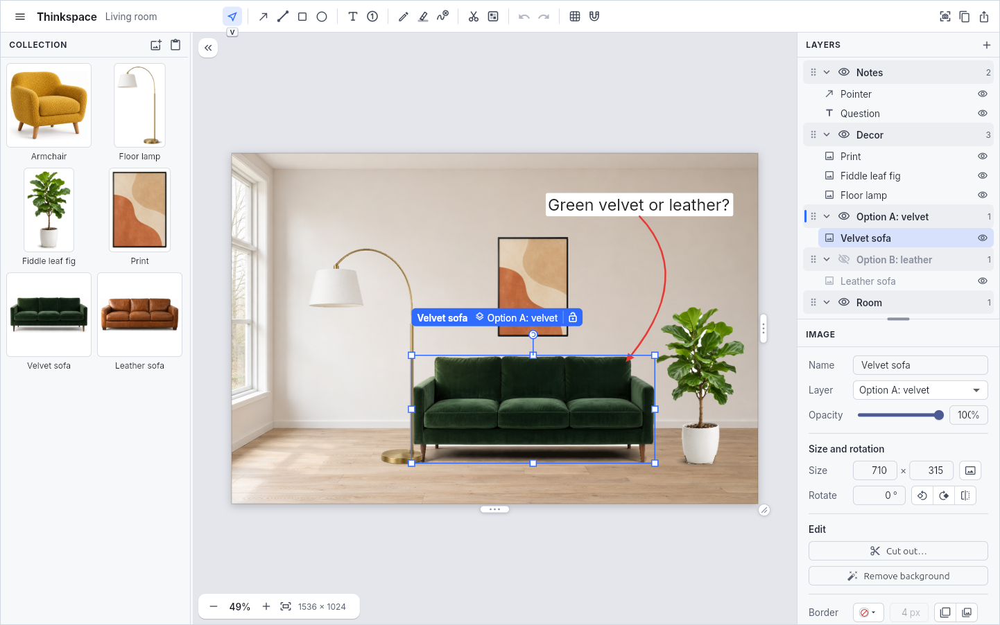
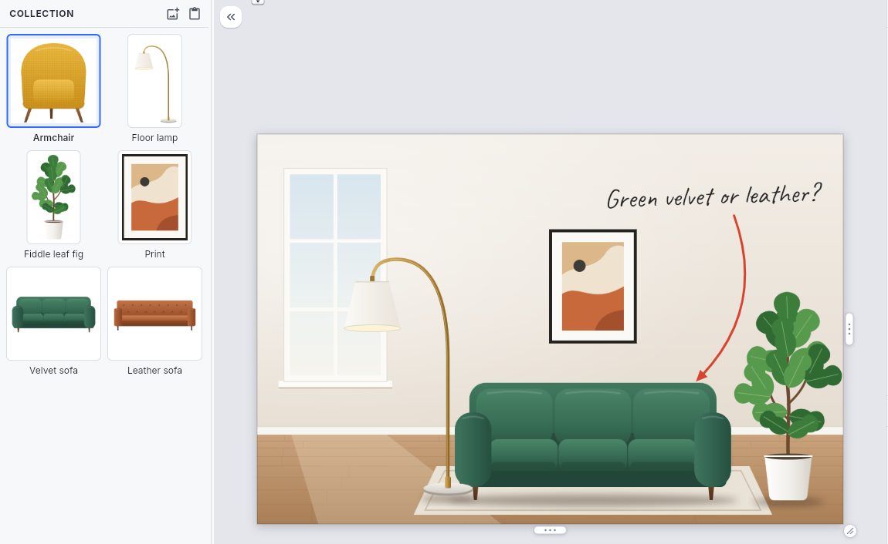
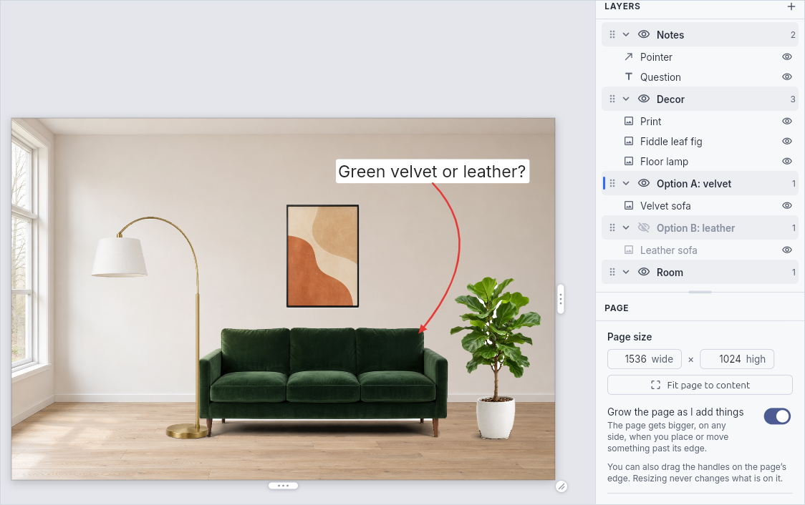
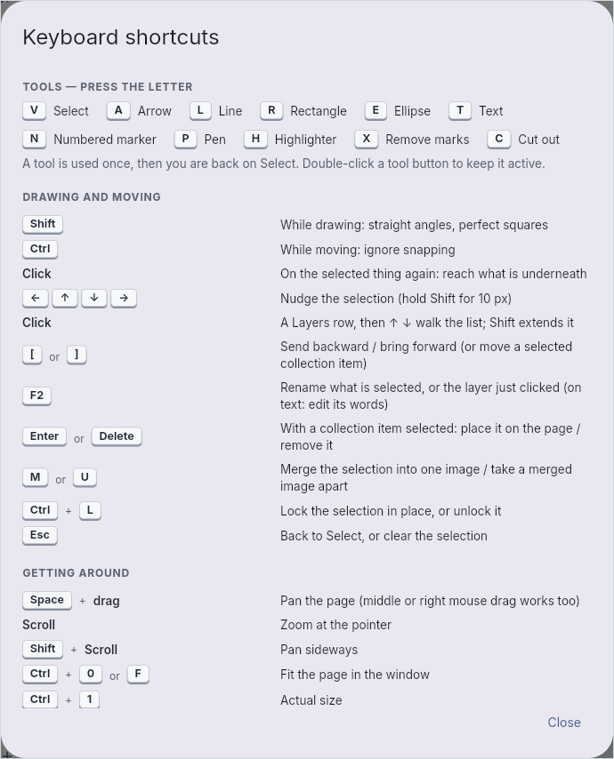

<p align="center">
  
</p>

<h1 align="center">Thinkspace</h1>

<p align="center">
  <b>Show someone what you mean.</b><br>
  Gather images, try them out on layers, mark them up, and send the result.
</p>

<p align="center">
  <a href="https://github.com/Remco28/thinkspace/actions/workflows/ci.yml"></a>
  <a href="https://github.com/Remco28/thinkspace/releases"></a>
  <a href="LICENSE"></a>
  
  
</p>

<p align="center">
  <a href="#install">Install</a> ·
  <a href="#a-first-five-minutes">First five minutes</a> ·
  <a href="docs/FEATURES.md">Features</a> ·
  <a href="docs/KEYBOARD.md">Shortcuts</a> ·
  <a href="docs/DEVELOPING.md">Build from source</a>
</p>



Thinkspace is a small desktop app for combining images, lines and layers to explain an idea. It is what you reach for when GIMP is too slow, Paint is too thin and you do not want to learn a drawing suite. It opens in under a second, fits in an 11 MB download, and every tool has a one-letter key.

It is not a photo editor, a vector studio or a drafting tool. The window holds a short toolbar, a shelf of images you have gathered, the layer list and the settings of whatever you selected.

## A shelf for your images



The collection on the left holds images you have gathered but not placed yet. Drag one onto the page to use it. The original stays on the shelf, so you can place it again, or cut out and resize the copy without losing anything.

- Paste straight into the collection with `Ctrl+Shift+V`, or drop files on it.
- Click an item, then `Enter` places it, `Delete` removes it and `F2` renames it.
- Drag one item onto another to rearrange the shelf, or use `[` and `]`.
- Resize the panel, or hide it when you need the room.

## Layers for trying options



Layers are for organising, not effects. Put each option on its own layer and click the eyes to flip between them, so the person you are showing can compare without you rebuilding anything.

- Click a layer to select everything on it, then drag to move it all together.
- Drag an object onto another layer and it keeps its place on the page. Drag it between other objects in the list to put it in front of or behind them.
- Show, hide, reorder and lock layers. A new layer opens its name for typing.
- Open up to ten images at once with `Ctrl+O` and each gets its own layer, named after its file.

## Keyboard first



Every tool has a single letter: `V` select, `A` arrow, `T` text, `H` highlighter, and so on. The active tool shows its key under its button, so you learn the keys by using the toolbar.

Press `?` or `F1` for the sheet on the right. The rest of the editing has keys too: nudging with the arrow keys, `[` and `]` for order, `F2` to rename, `Ctrl+L` to lock, `M` to merge and `Space` with a drag to pan. `S` takes a screenshot: Thinkspace steps aside, you pick part of the screen, and the picture lands on the page.

The full list is in [docs/KEYBOARD.md](docs/KEYBOARD.md).

<br clear="right">

## Light by design

| App | Installed size |
|---|---|
| **Thinkspace** | **27 MB**, everything included (an 11 MB download) |
| Inkscape | 93 MB, before its libraries |
| GIMP | 104 MB, before its libraries |
| Krita | 148 MB, before its libraries |

The other apps' sizes are their own packages in Ubuntu 24.04 (GIMP counts `gimp` and `gimp-data`, Krita counts `krita` and `krita-data`). They leave out the shared libraries each one pulls in, so the real gap is wider. Thinkspace's 27 MB includes its own engine and fonts.

The size comes from doing less. There are no plugins, accounts, filters, brushes or colour management. What is there:

- Arrows and lines that bend into curves and stay attached to what they point at.
- Text, numbered markers, rectangles, ellipses, a pen and a highlighter that keeps writing underneath readable.
- Screenshots taken from inside the app, or from anywhere with a shortcut you choose.
- Cut-outs and one-click background removal, which always make a new image and keep the original.
- Hide details boxes that pixelate or cover something before you share it.
- A page that grows to fit, and one undo step per gesture.
- PNG export, or copy the page or the selection straight to the clipboard.

Each feature is described in [docs/FEATURES.md](docs/FEATURES.md).

## Why it exists

Doing one small visual job used to mean bouncing between apps. One made a quick diagram, another marked up a screenshot, another tried an idea over a photo. The useful pieces were scattered across Xournal, GIMP and Paint.NET, and each came with a screen full of buttons. When the screen is hundreds of buttons, menus under menus and rows of status lines, the idea is gone before the work starts.

Thinkspace keeps the few things that job needs in one place and leaves the rest out. Every feature is weighed against these rules:

- **Little things stay little things.** A pasted image, a label or an arrow remains its own object until you merge it, and merging can be undone.
- **Arranging, not painting.** You move, size, turn and fade pieces. Nothing is smudged into the page. Operations that touch pixels, such as cutting out or removing a background, make a new image and keep the original.
- **The screen stays quiet.** There are few tools, each obvious, and the toolbar teaches the shortcuts.
- **One gesture, one undo.** What your hand did once, `Ctrl+Z` takes back once.
- **No graphics suite.** No masks, blend modes, filters, brushes, perspective or colour management. Each is reasonable alone. Together they would make this the slow app it replaces.

## Install

Releases are on the [releases page](https://github.com/Remco28/thinkspace/releases). Thinkspace is built and tested on Linux. The Windows build is newer and still being tried out. macOS is not attempted.

### Linux

Download `thinkspace-linux-x64.tar.gz`, then:

```bash
tar xzf thinkspace-linux-x64.tar.gz
cd thinkspace-linux-x64 && ./install.sh     # installs into ~/.local, no root needed
thinkspace
```

Pasting images from the clipboard uses `xclip` (X11) or `wl-clipboard` (Wayland):

```bash
sudo apt install xclip wl-clipboard
```

To remove it, run `./install.sh --remove` from the same folder. Your settings and unsaved work stay; `./install.sh --remove --purge` deletes them too.

#### What the installer changes

Everything is in your home folder, and `--remove` undoes all of it:

| What | Where | On `--remove` |
|---|---|---|
| The program and its licences | `~/.local/share/thinkspace/app` and `licenses` | Removed |
| The `thinkspace` command | `~/.local/bin/thinkspace`, a link | Removed |
| Menu entry, icons and the `.thinkspace` file type | `~/.local/share/applications`, `icons/hicolor` and `mime/packages`, whose desktop caches are refreshed | Removed, and the caches refreshed. Folders and caches it created are removed once empty |
| A record of the folders and caches it created | `~/.local/state/thinkspace/install` | Removed |
| Your settings and unsaved work, made by the app | `~/.local/share/thinkspace`, beside the program | Kept. `--purge` deletes them |
| The screenshot shortcut, only if you set one in the app | One "Thinkspace screenshot" entry in GNOME's custom keyboard shortcuts | Removed. Your other shortcuts are not touched |
| A socket for each open window, so the shortcut can find it | `$XDG_RUNTIME_DIR/thinkspace` | Removed as each window closes, and cleared at logout |

If you delete the files by hand instead, also delete "Thinkspace screenshot" under Settings → Keyboard → Custom Shortcuts. Left behind, it does nothing.

### Windows

Windows 10 or newer, 64-bit. Download one of these:

- `Thinkspace-Setup.exe` is an installer. It needs no administrator rights, adds a Start-menu entry and opens `.thinkspace` files on double-click.
- `thinkspace-windows-x64.zip` unzips anywhere. Run `thinkspace.exe`.

The program is not signed, so the first run may show "Windows protected your PC". Choose **More info**, then **Run anyway**.

The clipboard needs nothing extra: copy an image or image files in Explorer and paste them. Unsaved work is kept in `%APPDATA%\Thinkspace`.

The screenshot shortcut, if you set one, is a "Thinkspace screenshot" entry in your Start menu with your keys on it. The installer's uninstaller removes it. With the zip, delete it from the Start menu yourself.

Touch and pen work too. One finger does what the mouse does, two fingers move and zoom the page, and holding a finger on something opens its menu. A pen behaves like a mouse, and its barrel button is a right click.

## A first five minutes

1. Press `S` in Thinkspace and drag across part of the screen. Choose **Add to "Layer 1"**. The page becomes the size of your screenshot.
2. Press `A` and drag across the screen to draw an arrow. Drag either end to resize it. `Shift` keeps it straight.
3. Press `T`, click, type a note. Press `Esc` to finish.
4. Copy another image and press `Ctrl+Shift+V` to put it in the collection. Drag it onto the page, pull a corner to size it, and slide **Opacity** in the panel.
5. Add a layer (`+` in the Layers panel), drag the new image onto it in the list, and click the eye to flip between the two.
6. `Ctrl+E` exports a PNG. `Ctrl+Shift+C` copies the page so you can paste it into chat or email.

## Your files

A project is one editable `.thinkspace` file holding the objects, layers, collection and images. **Open recent** in the menu lists the last eight. Unsaved work is autosaved, each window on its own, and offered back after a crash. Closing with unsaved changes asks first.

## Build and contribute

You need the [Flutter SDK](https://docs.flutter.dev/get-started/install/linux) and, on Linux, a C++ toolchain:

```bash
sudo apt install clang cmake ninja-build pkg-config libgtk-3-dev
flutter pub get
flutter run -d linux
flutter analyze && flutter test        # the whole suite runs without a display
```

[docs/DEVELOPING.md](docs/DEVELOPING.md) covers packaging, the Windows build and the localhost inspector that lets a script or an agent look at the running app. [docs/ARCHITECTURE.md](docs/ARCHITECTURE.md) explains how the code fits together and why. [docs/DESIGN.md](docs/DESIGN.md) records the interface decisions. Before opening a pull request, run `dart format lib test && flutter analyze && flutter test`. All three must be clean.

Thinkspace should stay small. A new feature has to help with arranging, marking up or explaining. If it belongs in a graphics suite, it does not belong here.

## License

MIT, see [LICENSE](LICENSE). The bundled typefaces are under the SIL Open Font License, and their licences are in `assets/fonts/`. Inter is used for the interface and for sans text. Lora, JetBrains Mono and Caveat are the other typefaces for text on the page.

The furniture and room images in the screenshots were generated for this README.
