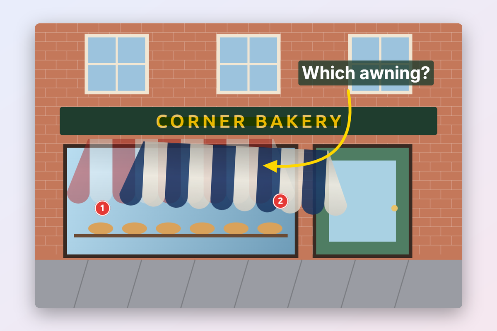
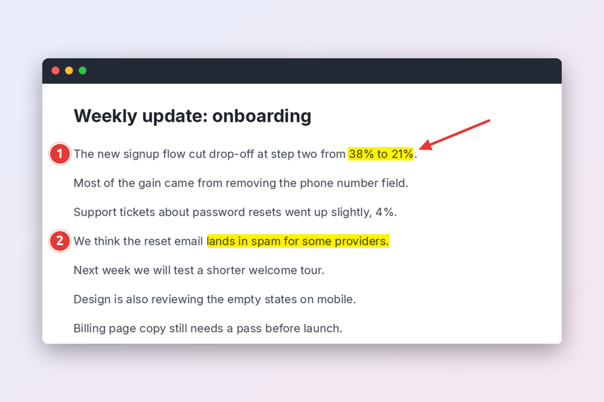
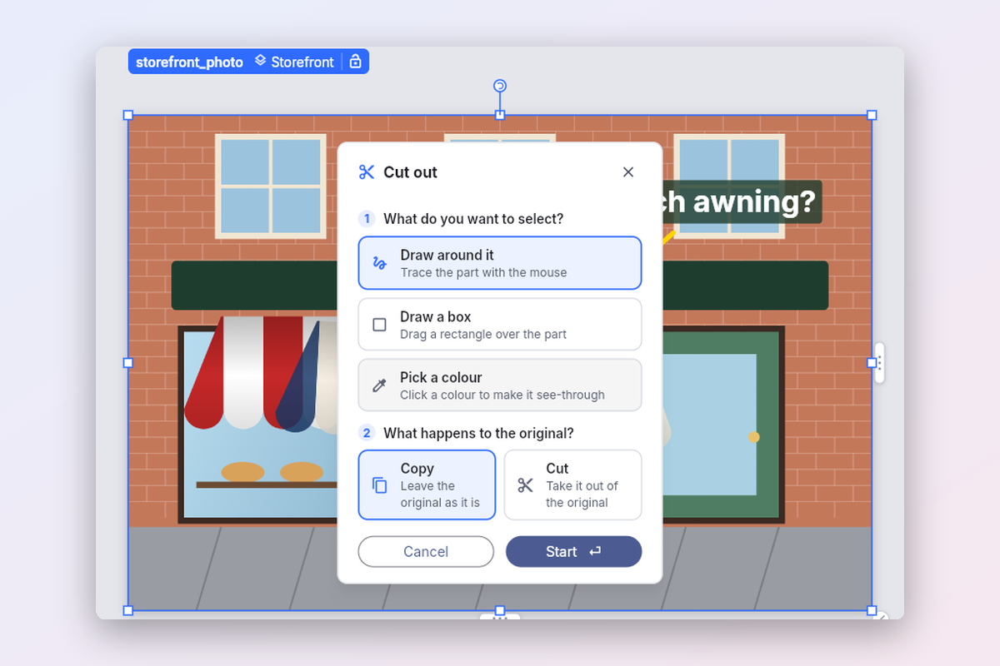
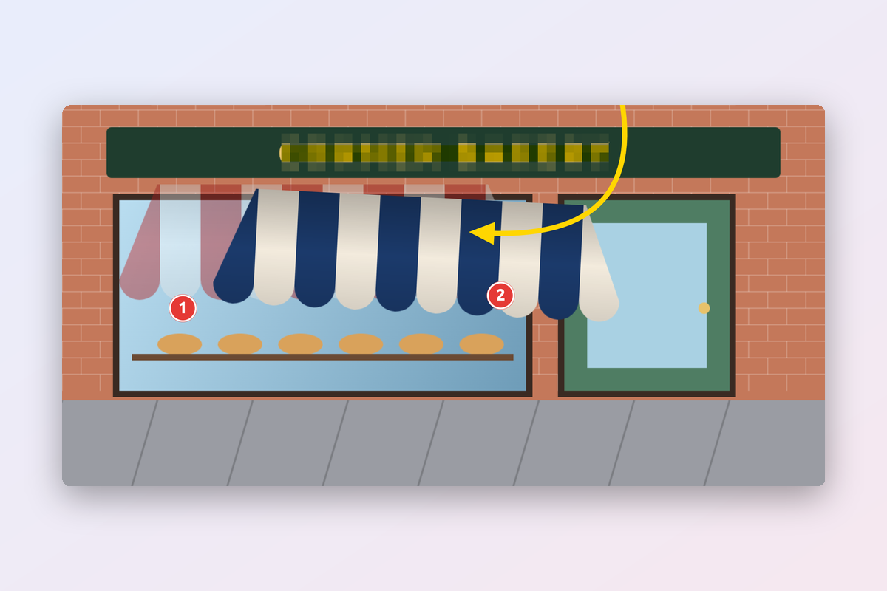
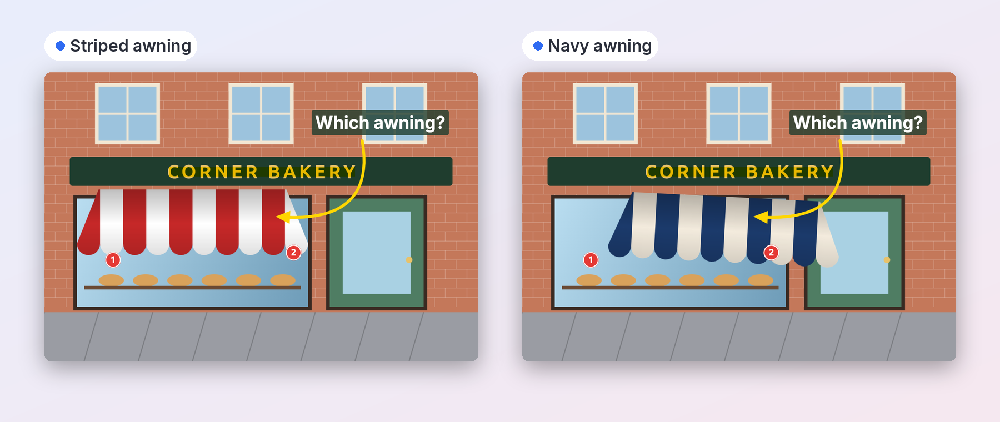

<p align="center">
  
</p>

<h1 align="center">Thinkspace</h1>

<p align="center">
  <b>Show someone what you mean.</b><br>
  Paste a screenshot, draw an arrow at the part that matters, and send it.
</p>

<p align="center">
  <a href="https://github.com/Remco28/thinkspace/actions/workflows/ci.yml"></a>
  <a href="https://github.com/Remco28/thinkspace/releases"></a>
  <a href="LICENSE"></a>
  
  
</p>

<p align="center">
  <a href="#install">Install</a> ·
  <a href="#a-first-five-minutes">First five minutes</a> ·
  <a href="docs/FEATURES.md">Features</a> ·
  <a href="docs/KEYBOARD.md">Shortcuts</a> ·
  <a href="docs/DEVELOPING.md">Build from source</a>
</p>

<p align="center">
  
</p>

Thinkspace is a small desktop app for combining images, lines and layers to explain an idea. It is what you reach for when GIMP is too slow, Paint is too thin and you do not want to learn a drawing suite.

It is not a photo editor, a vector studio or a drafting tool. The screen holds a short toolbar, a layer list, a shelf of source images and the few settings of whatever you selected.

## What you can do

<table>
  <tr>
    <td width="50%" valign="top">
      
      <b>Mark it up.</b> Straight or curved arrows and lines, numbered markers, text and a pen. Arrow ends stay attached to the things they point at when you move them.
    </td>
    <td width="50%" valign="top">
      
      <b>Highlight like a marker.</b> Drag over text in a screenshot. A quick, nearly level pass becomes a clean bar. Five colours, and the writing underneath stays dark.
    </td>
  </tr>
  <tr>
    <td width="50%" valign="top">
      
      <b>Cut things out.</b> Draw around a part of an image, drag a box or click a colour. The piece becomes a new object, and the original stays as it was.
    </td>
    <td width="50%" valign="top">
      
      <b>Hide what should not be shared.</b> A Hide details box pixelates or covers whatever is under it. It stays editable, and exports and copies carry only the hidden version.
    </td>
  </tr>
  <tr>
    <td colspan="2" valign="top">
      
      <b>Compare options with layers.</b> Put each option on its own layer and flip between them with the eye buttons. Layers are for organising: show, hide, reorder, lock and move together. There are no effects.
    </td>
  </tr>
</table>

Also in the box: background removal, a collection shelf for images you have not placed yet, a page that grows with your work, a grid, one undo step per gesture, and PNG export or copy to the clipboard. [The full list is in docs/FEATURES.md.](docs/FEATURES.md)

## Why it exists

Doing one small visual job used to mean bouncing between apps. One made a quick diagram, another marked up a screenshot, another tried an idea over a photo. The useful pieces were scattered across Xournal, GIMP and Paint.NET, and each came with a screen full of buttons. When the screen is hundreds of buttons, menus under menus and rows of status lines, the idea is gone before the work starts.

Thinkspace keeps the few things that job needs in one place and leaves the rest out. Every feature is weighed against these rules:

- **Little things stay little things.** A pasted image, a label or an arrow remains its own object until you merge it, and merging can be undone.
- **Arranging, not painting.** You move, size, turn and fade pieces. Nothing is smudged into the page. Operations that touch pixels, such as cutting out or removing a background, make a new image and keep the original.
- **The screen stays quiet.** There are few tools, each obvious, and the toolbar teaches the shortcuts.
- **One gesture, one undo.** What your hand did once, `Ctrl+Z` takes back once.
- **No graphics suite.** No masks, blend modes, filters, brushes, perspective or colour management. Each is reasonable alone. Together they would make this the slow app it replaces.

## Install

Releases are on the [releases page](https://github.com/Remco28/thinkspace/releases). Thinkspace is built and tested on Linux. The Windows build is newer and still being tried out. macOS is not attempted.

### Linux

Download `thinkspace-linux-x64.tar.gz`, then:

```bash
tar xzf thinkspace-linux-x64.tar.gz
cd thinkspace-linux-x64 && ./install.sh     # installs into ~/.local, no root needed
thinkspace
```

Pasting images from the clipboard uses `xclip` (X11) or `wl-clipboard` (Wayland):

```bash
sudo apt install xclip wl-clipboard
```

To remove it, run `./install.sh --remove` from the same folder.

### Windows

Windows 10 or newer, 64-bit. Download one of these:

- `Thinkspace-Setup.exe` is an installer. It needs no administrator rights, adds a Start-menu entry and opens `.thinkspace` files on double-click.
- `thinkspace-windows-x64.zip` unzips anywhere. Run `thinkspace.exe`.

The program is not signed, so the first run may show "Windows protected your PC". Choose **More info**, then **Run anyway**.

The clipboard needs nothing extra. Take a screenshot with `Win+Shift+S` and press `Ctrl+V`, or copy image files in Explorer and paste them. Unsaved work is kept in `%APPDATA%\Thinkspace`.

Touch and pen work too. One finger does what the mouse does, two fingers move and zoom the page, and holding a finger on something opens its menu. A pen behaves like a mouse, and its barrel button is a right click.

## A first five minutes

1. Take a screenshot to the clipboard, then press `Ctrl+V` in Thinkspace. Choose **Add to "Layer 1"**. The page becomes the size of your screenshot.
2. Press `A` and drag across the screen to draw an arrow. Drag either end to resize it. `Shift` keeps it straight.
3. Press `T`, click, type a note. Press `Esc` to finish.
4. Paste another image. It lands as its own object. Drag it, pull a corner, grab the round handle to rotate it, and slide **Opacity** in the panel.
5. Add a layer (`+` in the Layers panel), drag the second image onto it from the object list, and click the eye to flip between the two.
6. `Ctrl+E` exports a PNG. `Ctrl+Shift+C` copies the page so you can paste it into chat or email.

Every shortcut is in [docs/KEYBOARD.md](docs/KEYBOARD.md), and `?` shows the same sheet in the app.

## Your files

A project is one editable `.thinkspace` file holding the objects, layers and images. **Open recent** in the menu lists the last eight. Unsaved work is autosaved, each window on its own, and offered back after a crash. Closing with unsaved changes asks first.

## Build and contribute

You need the [Flutter SDK](https://docs.flutter.dev/get-started/install/linux) and, on Linux, a C++ toolchain:

```bash
sudo apt install clang cmake ninja-build pkg-config libgtk-3-dev
flutter pub get
flutter run -d linux
flutter analyze && flutter test        # the whole suite runs without a display
```

[docs/DEVELOPING.md](docs/DEVELOPING.md) covers packaging, the Windows build and the localhost inspector that lets a script or an agent look at the running app. [docs/ARCHITECTURE.md](docs/ARCHITECTURE.md) explains how the code fits together and why. [docs/DESIGN.md](docs/DESIGN.md) records the interface decisions. Before opening a pull request, run `dart format lib test && flutter analyze && flutter test`. All three must be clean.

Thinkspace should stay small. A new feature has to help with arranging, marking up or explaining. If it belongs in a graphics suite, it does not belong here.

## License

MIT, see [LICENSE](LICENSE). The bundled typefaces are under the SIL Open Font License, and their licences are in `assets/fonts/`. Inter is used for the interface and for sans text. Lora, JetBrains Mono and Caveat are the other typefaces for text on the page.
